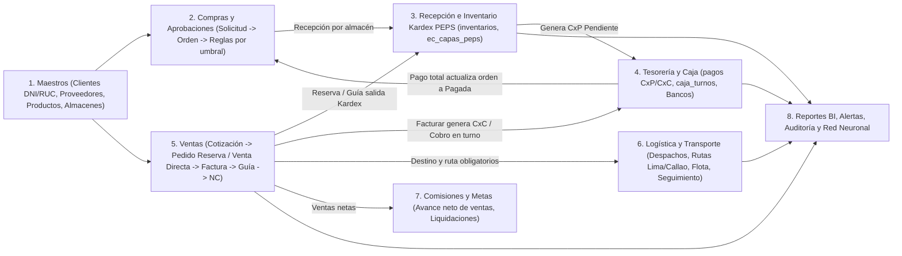

# Guía Completa de Uso, Estudio y Presentación de Avances — EnterpriseCloud

> **Propósito de este documento:** servirte como **manual de estudio** y **guión técnico de demostración en vivo** para presentar avances de **EnterpriseCloud** (*NewEnterpriseCloud*) ante tu profesor. Toda ruta, tabla, función RPC y comportamiento descrito aquí está contrastado contra el código fuente y la base de datos conectada en Supabase.

---

## 1. Resumen Ejecutivo y Arquitectura del Sistema

**EnterpriseCloud** es un ERP modular conectado en tiempo real a **Supabase** sin datos ficticios de demostración en los flujos operativos principales: el panel ejecutivo, los reportes, las cuentas, el inventario, las rutas y los registros maestros consultan el mismo estado persistido en PostgreSQL.

### 1.1 Stack Tecnológico

| Capa | Tecnología | Responsabilidad principal |
|---|---|---|
| Frontend SPA | React 19 + TypeScript + Vite + React Router DOM v7 | Interfaz modular de 12 módulos ERP + Analizador de proyectos (`src/routes/AppRouter.tsx`). |
| Autenticación y Perfil | Supabase Auth + `public.usuarios` + `roles` / `rol_permisos` / `usuario_permisos` | Control de acceso basado en roles y permisos por módulo (`ver`, `crear`, `editar`, `eliminar`, `aprobar`). |
| Base de Datos y Seguridad | PostgreSQL + Row Level Security (RLS) + `app_private` | Aislamiento por permisos en servidor; operaciones sensibles escritas solo por RPC `SECURITY DEFINER` con verificación explícita de sesión y permiso. |
| Consistencia Transaccional | Funciones PL/pgSQL idempotentes (`p_key` / `idempotency_key`, locks de asesoría) | Evitan duplicidad de compras, recepciones, cobros, pagos, reservas, facturas, guías y movimientos de inventario ante doble clic o reintento de red. |
| Serverless | Supabase Edge Functions (`peru-document-lookup`, `project-analyzer`) | Consultas externas y análisis de proyectos en servidor sin exponer tokens ni secretos en variables `VITE_*` del navegador. |
| Trazabilidad | Triggers `trg_auditoria` (`fn_auditar`) + `public.auditoria` | Registro de inserciones, ediciones y eliminaciones en las tablas operativas y de configuración. |

### 1.2 Mapa del Flujo Operativo Integral

### 1.3 Principios de Diseño para Explicar al Profesor

1. **Fuente única de verdad:** cada dato maestro y cada saldo pertenece a un solo origen. Los productos y precios lista nacen en **Maestros / Inventario**, las existencias por almacén en `inventarios`, el costo histórico en `ec_capas_peps` / `ec_kardex_valorizado`, y las obligaciones en `pagos` (CxC / CxP).
2. **Separación entre orden, físico y dinero:**
   - Una **orden de compra** con productos no ingresa stock ni se marca `Pagada` al crearse: primero pasa por aprobación (si aplica), luego ingresa mercadería en **Recepción de mercadería (`/ingreso-kardex`)** generando entrada en Kardex y CxP `Pendiente`, y recién pasa a `Pagada` cuando Tesorería cancela la CxP.
   - En **Ventas**, un **Pedido con reserva** separa el stock libre sin retirarlo del almacén, **Facturar** genera el comprobante (`ec_comprobantes`) y la CxC, y **Emitir guía** ejecuta la salida física oficial en Kardex una sola vez.
3. **El frontend es conveniencia UX; el servidor es la frontera de seguridad:** ocultar un botón en React no basta. Tanto RLS como las RPC validadas verifican `auth.uid()` y `public.tiene_permiso(...)`.
4. **Idempotencia:** la creación de pedidos, facturas, guías, notas de crédito, cobros, transferencias y recepciones utiliza claves `idempotency_key` + hash del payload para impedir duplicados ante fallos de red.

---

## 2. Guía Rápida de Arranque y Accesos

### 2.1 Variables de Entorno y Comandos Locales

- Archivo `.env` requerido en la raíz del frontend:
  - `VITE_SUPABASE_URL`
  - `VITE_SUPABASE_ANON_KEY`
- Comandos principales (en Windows PowerShell, si hubiera restricción de ejecución usar `npm.cmd`):

| Comando | Qué verifica / inicia |
|---|---|
| `npm install` | Instala dependencias del proyecto (`react`, `vite`, `lucide-react`, `@supabase/supabase-js`, `jszip`, etc.). |
| `npm run dev` | Levanta el servidor de desarrollo Vite en `http://localhost:5173`. |
| `npm run typecheck` | Ejecuta `tsc --noEmit` para validar tipado estricto de TypeScript. |
| `npm test` | Ejecuta las pruebas unitarias con `node --test` (actualmente **126 / 126 pruebas** en verde). |
| `npm run build` | Verifica tipos y genera el bundle de producción en `dist/`. |

> **Regla estricta de secretos:** nunca agregues claves privadas (`PERU_API_TOKEN`, `SUPABASE_SERVICE_ROLE_KEY`, claves de APIs de IA) en variables `VITE_*`. Todo secreto debe vivir únicamente en los secretos de Supabase Edge Functions.

### 2.2 Cuentas, Roles y Seguridad en Vivo

- Al iniciar sesión en `/login`, `RequireAuth` verifica una sesión real de Supabase Auth, carga el perfil de `public.usuarios` y lee sus permisos efectivos (`rol_permisos` + excepciones en `usuario_permisos`).
- Los módulos sin permiso para el rol activo se ocultan en el menú lateral y sus rutas devuelven `"Acceso restringido"` en UI y error `42501` en PostgreSQL si se intentaran llamar directamente.

---

## 3. Manual Operativo Completo — Los 12 Módulos + Analizador

### Módulo 1 · Maestros

**Rutas:** `/customers` · `/suppliers` · `/inventory#productos` · `/mantenimientos#empresa` · `/mantenimientos#organizacion` · `/mantenimientos#zonas-comerciales` · `/maestros#personas` · `/maestros#catalogos`

**Para qué sirve:** centraliza las entidades reutilizables de toda la operación: clientes, proveedores, catálogo de productos, sucursales, almacenes, zonas, transportistas, vendedores y catálogos tributarios/monedas.

#### Novedades clave en Clientes (`/customers`)
1. Al pulsar **Nuevo cliente**, el formulario (`RecordModal.tsx`) permite elegir primero el **Tipo de cliente**:
   - **Persona natural · DNI**: cambia la etiqueta principal a **Nombres y apellidos** y habilita búsqueda opcional contra **RENIEC**.
   - **Empresa · RUC**: cambia la etiqueta principal a **Razón social** y habilita búsqueda opcional contra **SUNAT**.
2. En el bloque **02 · Dirección y contacto (opcional al registrar)** puedes ingresar o dejar vacía la **Dirección de entrega / domicilio**, el **Teléfono** y el **Correo electrónico** (`public.clientes`). Si se realiza búsqueda RENIEC/SUNAT y el servicio devuelve dirección, se autocompleta.
3. Puedes definir **Línea de crédito (S/)** en la sección `03 · Condiciones comerciales` (usada cuando el cliente compra con método que consume línea, como Tarjeta).

#### Proveedores (`/suppliers`) y Catálogo de Proveedor
- Exige **RUC (11 dígitos)** validable con SUNAT (`lookupRuc`).
- Permite registrar productos que ofrece ese proveedor con su costo base sin IGV; luego en **Compras**, si un artículo del proveedor aún no existe en tu maestro de inventario, puedes usar el botón **"Crear ficha (stock 0) y vincular"** para dar de alta el SKU en Inventario sin mezclar el stock inicial hasta su recepción física.

#### Transportistas, Vendedores y Catálogos (`/maestros`)
- **`#personas`:** alta/edición/activación de transportistas y vendedores vinculados a sucursales y usuarios.
- **`#catalogos`:** tipo de cambio diario USD (`monedas`), unidades y categorías comerciales/tributarias (`catalogos_negocio`).

---

### Módulo 2 · Compras y Aprobaciones de Abastecimiento

**Rutas:** `/purchases` · `/solicitudes-compra` · `/ingreso-kardex` · `/devoluciones-proveedor` · `/contratos-compra` · `/importaciones` · `/evaluaciones-proveedores`

**Para qué sirve:** controla el abastecimiento nacional e importado desde el requerimiento interno hasta la recepción física y evaluación del proveedor.

#### Flujo Completo de Compra Nacional
1. **Solicitud y comparativo (`/solicitudes-compra`):** usa el **Modelo A** (`solicitudes_compra` → `solicitud_compra_lineas` → `ofertas_compra` → `detalle_ofertas_compra`) para cotizar con múltiples proveedores y seleccionar la oferta ganadora.
2. **Orden de compra (`/purchases` → *Nueva compra*):**
   - Vincula el **Proveedor**, elige **Moneda (`PEN` / `USD`)** (en USD exige tipo de cambio manual), selecciona líneas de su catálogo con tratamiento tributario (`Gravado 18%`, `Exonerado` o `Inafecto`) o registra un servicio/gasto sin líneas.
   - Al guardar, llama a la RPC de solicitud de aprobación (`requestPurchaseApproval`).
3. **Aprobación bajo umbral vs. manual (`/aprobaciones`):**
   - Si el total estimado en PEN está **por debajo** del umbral activo `orden_compra_monto_minimo_pen` en `ec_reglas_aprobacion`, el trigger `ec_solicitudes_aprobacion_autoaprobar` la emite automáticamente y deja evento con `auto_aprobada: true`.
   - Si la regla está desactivada o el total es **mayor o igual** al umbral, queda en cola (`Pendiente`) hasta que otro usuario con rol Gerente o Administrador apruebe en `/aprobaciones`. En `/purchases`, un banner y la métrica superior muestran cuántas órdenes esperan aprobación.
4. **Recepción física de mercadería (`/ingreso-kardex`):**
   - Las órdenes con bienes nacen en estado **`Pendiente`** y **`Recepción: pendiente`** (no entran automáticamente al inventario).
   - Al entrar a `/ingreso-kardex` → **Recibir**, eliges el **almacén destino** y las cantidades recibidas (recepción parcial o completa) con su comprobante.
   - Al confirmar: sube `inventarios` + `productos.stock`, crea capa PEPS (`ec_capas_peps`), registra movimiento `entrada` en Kardex y genera la **Cuenta por Pagar (CxP)** en `Pendiente` dentro de Tesorería.
5. **Otras pantallas de Compras:**
   - `/devoluciones-proveedor`: devolución física referenciada a recepción.
   - `/contratos-compra`: contratos marco y liberaciones parciales.
   - `/importaciones`: carpetas de importación (`carpetas_importacion`, vinculación de órdenes y seguimiento).
   - `/evaluaciones-proveedores`: calificación de entrega/calidad por orden.

---

### Módulo 3 · Ventas

**Rutas:** `/quotes` · `/sales` · `/sales/receipts` · `/sales/guides` · `/sales/sunat` · `/sales/credits`

**Para qué sirve:** gestiona propuestas comerciales, reservas de stock, venta directa en mostrador, emisión de comprobantes imprimibles, guías de despacho y notas de crédito.

#### Modalidades en Pedidos y Ventas (`/sales`)
1. **Cotizaciones (`/quotes`):** propuestas comerciales versionadas (`ec_cotizaciones` / `ec_cotizacion_versiones`) con fecha de vigencia; no descuentan stock hasta convertirse a pedido.
2. **Pedido con reserva (`/sales` → modo `Pedido con reserva`):**
   - Seleccionas **Cliente**, **Almacén de reserva**, **Moneda (`S/ PEN` o `$ USD`)**, **Dirección / ruta de entrega (obligatoria)** y los **Productos** (muestra el stock *Libre estimado*).
   - Si el cliente seleccionado no tenía dirección guardada, `/sales` exige ingresarla para confirmar el pedido y la guarda tanto en el pedido (`ec_pedidos.direccion_entrega`) como en la ficha del cliente (`clientes.direccion`) mediante la RPC `ec_guardar_direccion_entrega_v1`.
   - Pulsar **Reservar pedido** bloquea stock sin retirarlo físicamente del almacén (`ec_reservas`, estado **`Reservado`**). Desde aquí puedes **Facturar** o **Anular pedido** (libera la reserva).
3. **Venta directa (`/sales` → modo `Venta directa` o botón *Registrar venta*):**
   - Pensada para atención inmediata: en una sola confirmación crea el pedido, emite el comprobante (**Boleta** o **Factura · RUC**) y registra el cobro (**Efectivo** con turno abierto, **Yape**, **Plin**, **Transferencia** o **Tarjeta**).
4. **Facturación, Cobro y Guía de Remisión:**
   - **Facturar:** emite el comprobante en `ec_comprobantes` (exige RUC de 11 dígitos si es Factura `01`), crea la fila en `ventas` y genera la CxC en `pagos`. Si se cobra en ese paso, salda la CxC.
   - **Cobrar:** disponible en pedidos con `CxC pendiente`.
   - **Emitir guía (`/sales/guides` o botón *Emitir guía*):** prellena **Dirección de origen** (almacén del pedido) y **Dirección de destino** (dirección guardada del pedido/cliente). Al confirmar, consume la reserva, ejecuta la salida única del inventario en **Kardex** (`ec_emitir_guia`) y pasa el pedido a **`Despachado`**.
5. **Comprobantes (`/sales/receipts`), Notas de crédito (`/sales/credits`) y Emisión SUNAT (`/sales/sunat`):**
   - `/sales/receipts`: vista e impresión A4 / ticket del comprobante generado.
   - `/sales/credits`: emisión de nota de crédito contra el saldo no cobrado, con opción de **devolver físicamente los productos al almacén** (reingreso a Kardex).
   - `/sales/sunat`: deja preparados los snapshots UBL 2.1 en Supabase e informa de forma explícita cuando no existe un OSE/PSE conectado (imprimir no equivale a envío SUNAT ni CDR).

---

### Módulo 4 · Inventario y Kardex

**Rutas:** `/inventario/existencias` · `/inventario/kardex` · `/inventario/transferencias` · `/inventario/ajustes` · `/inventario/fisico` · `/inventario/lotes-series`

**Para qué sirve:** administra el stock físico real por almacén, su valorización PEPS y todos los movimientos auditables.

- **Existencias (`/inventario/existencias`):** saldo por almacén (`inventarios`), diferencia stock físico, reservado y disponible, y valorización PEPS actual (`ec_consultar_valorizacion_peps_actual_v1`).
- **Kardex (`/inventario/kardex`):** historial detallado (`ec_consultar_kardex`) de entradas, salidas, ajustes y transferencias con filtro por fecha, producto, referencia o GUID de documento, y saldo anterior/posterior + costo PEPS/promedio.
- **Transferencias entre almacenes (`/inventario/transferencias`):** mueve unidades de un almacén origen a otro destino en una transacción atómica (salida + entrada + traslado de capas PEPS).
- **Ajustes (`/inventario/ajustes`):** altas o bajas justificadas por merma, daño o regularización con motivo obligatorio y costo opcional.
- **Inventario físico (`/inventario/fisico`):** abre conteos por almacén (`ec_conteos_fisicos`), compara stock contado vs. sistema y concilia diferencias (sujetas al umbral de aprobación `conteo_fisico_variacion_maxima_unidades` en `/aprobaciones#reglas`).
- **Lotes y series (`/inventario/lotes-series`):** configuración de trazabilidad por producto y registro de `ec_lotes` y `ec_series` asociados a movimientos.

---

### Módulo 5 · Tesorería

**Rutas:** `/finance` · `/caja` · `/tesoreria`

**Para qué sirve:** controla cuentas por cobrar y pagar, turnos de caja en efectivo y cuentas bancarias con conciliación.

- **Cuentas por cobrar y pagar (`/finance`):** lista las obligaciones (`pagos`), muestra saldo pendiente real mediante `obtener_saldos_cuentas`, y permite abonos parciales o cancelación total eligiendo medio de pago. Al cancelar la CxP de una compra o la CxC de una venta, actualiza automáticamente el estado del documento origen (`Pagada` / `Completada`).
- **Cajas y turnos (`/caja`):** registra cajas por sucursal y apertura/cierre de turnos (`caja_turnos`). Toda cobranza o pago en **Efectivo** exige seleccionar un turno abierto y al cierre calcula el saldo esperado vs. el conteo físico declarado en PEN y USD.
- **Bancos, flujo y conciliación (`/tesoreria`):** alta y activación de cuentas bancarias por RPC, registro de ingresos/egresos bancarios, transferencias entre cuentas y conciliación línea por línea contra extracto bancario.

---

### Módulo 6 · Logística y Transporte

**Rutas:** `/logistica/despachos` · `/logistica/rutas` · `/logistica/flota` · `/logistica/seguimiento`

**Para qué sirve:** organiza el reparto físico de las ventas, planifica recorridos sobre calles de Lima y Callao, valida requisitos de flota y registra incidencias de entrega.

- **Planificación de despachos (`/logistica/despachos`):**
  - Pestaña **Por despachar**: muestra ventas con **Zona** (asignada en `zonas_clientes` o inferida automáticamente del distrito en la dirección, priorizando nombres explícitos de distrito sobre vías compartidas) y **Dirección de entrega**.
  - Al marcar una o varias ventas y pulsar **Nuevo despacho / Asignar ruta**, creas un despacho asignando vehículo, conductor, prioridad y orden de paradas.
- **Mapa y repertorio de rutas (`/logistica/rutas`):**
  - Muestra el mapa interactivo de Lima Metropolitana y Callao con **Estacionamiento Base (`P`)**, paradas asignadas desde pedidos o manuales, cálculo de distancia/tiempo y **Optimización por cercanía**.
  - Persiste en Supabase en `logistica_estacionamientos` y `logistica_rutas`, guardando un **Repertorio y destinos frecuentes** con estadísticas de repetición por cliente/distrito.
- **Vehículos y conductores (`/logistica/flota`):** maestro de unidades, capacidad en kg, conductores con categoría de licencia, y validación automática de vigencia de SOAT, revisión técnica y no cruce de horarios.
- **Seguimiento, entrega y devoluciones (`/logistica/seguimiento`):** cambia el estado del despacho (`programado` → `en_ruta` → `completado`), registra entregas totales, parciales o rechazadas por parada e incidencias.

---

### Módulo 7 · Comisiones de Vendedores

**Ruta:** `/comisiones` (`#reglas`, `#calculo`, `#liquidaciones`, `#historial`)

**Para qué sirve:** calcula remuneración variable sobre ventas completadas en hora comercial de Perú.

- **`#reglas`:** configura reglas generales, escalas por rango y excepciones por vendedor.
- **`#calculo`:** asocia ventas sin vendedor asignado y ejecuta el cálculo del período seleccionado.
- **`#liquidaciones` y `#historial`:** aprueba/liquida montos calculados, permite ajustes positivos/negativos trazables y registra pagos (con asiento bancario opcional y exportación CSV).

---

### Módulo 8 · Metas y Objetivos

**Ruta:** `/metas` (`#definicion`, `#avance`, `#ranking`)

**Para qué sirve:** define cuotas comerciales y mide el cumplimiento real en tiempo real.

- **`#definicion`:** creación de metas (`metas`) y reparto de cuotas (`metas_asignaciones`) por vendedor, sucursal o producto.
- **`#avance`:** compara el avance real contra el ritmo esperado del período (con marcador visual verde/ámbar/rojo), descontando devoluciones/notas de crédito.
- **`#ranking`:** tabla de posiciones y generación de cortes históricos (`metas_cortes`).

---

### Módulo 9 · Reportes e Inteligencia de Negocios

**Rutas:** `/dashboard` · `/reports` · `/inteligencia/red-neuronal`

- **Panel ejecutivo (`/dashboard`):** resumen gerencial con ventas y compras por período sobre fechas reales, serie diaria, alertas rápidas y saldos financieros separados por moneda (`PEN` / `USD`) sin mezclar tipos de cambio ficticios.
- **Reportes operativos (`/reports`):** tarjetas interactivas con rango de fechas y exportación CSV en flujos detallados:
  - Ventas del período, Compras por proveedor, Valorización de inventario, **Valorización PEPS actual** (verifica que todas las ubicaciones coincidan entre stock físico y saldo PEPS antes de publicar el total), Cuentas por cobrar, **Actividad de Tesorería** (desglosada en `PEN`/`USD` y medios de pago) y **Movimientos de Kardex**.
- **Red neuronal empresarial (`/inteligencia/red-neuronal`):** lienzo SVG animado (`ERP → representación compartida → 4 cabezas de salida`: Quiebre de stock, Cumplimiento, Morosidad CxC/CxP, Ranking IA) con controles de pausa, velocidad (`0.5×`, `1×`, `2×`), inspector por neurona y bandeja de recomendaciones IA con feedback (`Útil` / `Descartar`).
  - *Importante al exponer:* actualmente esta pantalla funciona en estado **`DEMO`** con señales de conteo enlazadas al ERP mientras se construye el backend MLOps (`ml_*` + Edge Function `enterprise-neural-engine`).

---

### Módulo 10 · Seguridad y Auditoría

**Rutas:** `/permisos` · `/auditoria` · `/perfil`

- **Permisos (`/permisos`):** lista de usuarios de `usuarios`, asignación de rol por cuenta, activación/desactivación de acceso, **Guía de roles** y ajuste granular de excepciones por usuario. La cuenta administradora protegida y la propia sesión están bloqueadas contra auto-degradación accidental.
- **Bitácora de auditoría (`/auditoria`):** visor de solo lectura sobre `public.auditoria` filtrable por módulo (más de 60 tablas auditadas), acción (`INSERT`, `UPDATE`, `DELETE`) y rango, mostrando JSON antes/después del cambio.

---

### Módulo 11 · Configuración e Integraciones

**Ruta:** `/mantenimientos` (`#empresa`, `#organizacion`, `#catalogos`, `#integraciones`, `#respaldos`, `#api-webhooks`)

- **`#empresa` y `#organizacion`:** ficha fiscal del emisor (`empresas`) y gestión de sucursales, almacenes y zonas comerciales/reparto (incluye apertura inicial por almacén).
- **`#catalogos`:** categorías, unidades de medida enteras, métodos de pago y monedas activas.
- **`#integraciones` (Datos de cobro):** carga y vista previa de QR **Yape**, QR **Plin** y datos de cuenta para **Transferencia bancaria** (solo informativos en el checkout de Ventas).
- **`#respaldos`:** exportación operativa en JSON (con aviso explícito de que no incluye Auth, esquema ni migraciones).
- **`#api-webhooks`:** tarjeta de verificación de configuración de **RENIEC / SUNAT (`peru-document-lookup`)** (informa si el secreto servidor existe sin exponerlo nunca) y tarjeta del **Motor neuronal multitarea** con enlace directo a `/inteligencia/red-neuronal`.

---

### Módulo 12 · Notificaciones y Aprobaciones

**Rutas:** `/notificaciones` · `/aprobaciones` · `/aprobaciones#reglas`

- **Centro de alertas (`/notificaciones`):** agrupa alertas operativas persistentes por usuario de **Inventario**, **Tesorería**, **Compras**, **Aprobaciones** y **Alertas predictivas** (fuente `predictive`, calculada mediante suavizado exponencial EWMA con cobertura de 28 días de salidas históricas y preparada vía `PredictiveAlertProvider` para conectar modelos externos). Permite marcar como leída o archivar sin perder historial.
- **Bandeja de aprobaciones (`/aprobaciones`):** revisa solicitudes pendientes de órdenes de compra manuales/ofertas/contratos y ajustes de conteo físico. Exige **segregación de funciones** (quien solicita no puede aprobar ni rechazar su propia solicitud) y solicita motivo obligatorio al rechazar, usando diálogo de confirmación con resumen completo.
- **Workflows y reglas (`/aprobaciones#reglas`):** permite a Gerente o Administrador activar y editar en vivo los umbrales de **`orden_compra_monto_minimo_pen`** y **`conteo_fisico_variacion_maxima_unidades`**, quedando cada cambio auditado en `auditoria`.

---

### Herramienta Transversal · Analizador de Proyectos

**Ruta:** `/analizador`

**Para qué sirve:** evalúa la arquitectura, seguridad, escalabilidad y preparación Cloud/AWS de proyectos externos subiendo un `.zip` (hasta 60 MB en navegador, filtrando `node_modules`/`.venv`/binarios) o pegando la URL de un repositorio público de GitHub o GitLab.

- Requiere consentimiento explícito antes de enviar rutas y muestras de texto a la Edge Function `project-analyzer`.
- Devuelve puntuaciones (**General 40/30/30**, **Seguridad**, **Escalabilidad**, **Preparación cloud**), servicios **AWS recomendados** con señales detectadas y lista de **Hallazgos** por severidad (`Crítica`, `Alta`, `Media`, `Baja`).
- Permite guardar informes en `analisis_proyectos` (**Historial de análisis**), exportar CSV e imprimir.
- *Estado técnico actual:* ejecuta motor determinista en servidor (`handleProjectAnalyzer.ts`); falta conectar el proveedor de IA generativa en servidor como etapa principal/complementaria (Tarea 6).

---

## 4. Guión de Presentación en Vivo ante el Profesor (12–15 Minutos)

Usa esta secuencia recomendada para mostrar que los módulos están conectados de verdad y no son pantallas aisladas:

### Bloque 1 · Seguridad, Maestros y Clientes Mejorados (2 min)
1. Abre **`/dashboard`** para mostrar la visión general y métricas reales.
2. Ve a **`/customers` → *Nuevo cliente***:
   - Muestra el selector **Tipo de cliente** (`Persona natural · DNI` vs. `Empresa · RUC`), cómo cambia dinámicamente **Nombres y apellidos** ↔ **Razón social**, y que la dirección puede dejarse **opcional** al registrar a la persona.
   - Si cuentas con `PERU_API_TOKEN` configurado en pruebas o un registro ya creado (`CLI-008` / `CLI-010`), muestra el detalle completo en la tabla.

### Bloque 2 · Reglas de Aprobación + Abastecimiento Completo (4 min)
1. Abre **`/aprobaciones#reglas`**: explica las dos reglas de autoaprobación editables por Gerente/Administrador y su registro en `auditoria`.
2. Ve a **`/purchases` → *Nueva compra***:
   - Selecciona un proveedor vinculado, marca un producto maestro (menciona la opción de **crear ficha SKU con stock 0 en 1 clic** si el catálogo del proveedor aún no está en inventario).
   - Al guardar, enfatiza que **no nace Pagada ni entra al stock automáticamente**: nace en **`Pendiente`** (`Recepción: pendiente`). Si supera el umbral, aparece el aviso de aprobación pendiente en **`/aprobaciones`**.
3. Ve a **`/ingreso-kardex` → *Recibir*** sobre una orden aprobada:
   - Elige almacén destino, recibe unidades y confirma.
   - Muestra en **`/inventario/kardex`** la nueva **`entrada`**, el aumento real en existencias y en **`/finance`** la **CxP `Pendiente`** generada.
4. En **`/finance`**, cancela la CxP (en efectivo con turno abierto en `/caja` o mediante Yape/transferencia) y muestra que la orden de compra recién pasa automáticamente a **`Pagada`**.

### Bloque 3 · Ciclo Comercial en Ventas: Reserva vs. Venta Directa (4 min)
1. Abre **`/sales`**:
   - Selecciona un cliente **sin dirección**: muestra cómo el formulario prellena dirección si el cliente ya tiene una, o **exige obligatoriamente la «Dirección / ruta de entrega»** antes de permitir reservar o vender.
   - Crea un **Pedido con reserva** y señala el estado **`Reservado`** (stock separado, aún sin salida en Kardex).
   - Ejecuta **`Facturar`** (Boleta o Factura RUC) → genera el comprobante imprimible y la CxC.
   - Abre **`Emitir guía`**: señala cómo el **origen (almacén)** y el **destino (dirección del pedido/cliente)** ya vienen prellenados y recién ahí se ejecuta la salida física en Kardex pasando a **`Despachado`**.
   - Cambia el selector superior a **`Venta directa`** para demostrar cómo el mismo motor permite cobrar y facturar en mostrador en un solo paso cuando el cliente compra al instante.

### Bloque 4 · Logística, Reportes, Alertas y Cierre Técnico (3 min)
1. Abre **`/logistica/despachos`** y **`/logistica/rutas`**:
   - Señala la tabla *Por despachar* mostrando la **dirección de entrega** y la **zona/distrito** inferidos automáticamente (`Lima Moderna · Lince`, `Lima Norte · Los Olivos`, etc.), y el mapa vial con estacionamiento base y repertorio persistido en Supabase.
2. Abre **`/reports`**: muestra la **Valorización PEPS actual** conciliada por almacén y los reportes exportables a CSV de Tesorería y Kardex.
3. Abre **`/notificaciones`** (destaca **Alertas predictivas** con cobertura de stock) y **`/inteligencia/red-neuronal`** (explica la arquitectura de 6 señales de entrada → 4 salidas y aclara honestamente que está en estado **DEMO** lista para conectarse a `enterprise-neural-engine`).
4. Finaliza en **`/auditoria`** mostrando el registro automático de las operaciones recién hechas en vivo.

---

## 5. Estado Real de Avances vs. Pendientes (Hoja de Ruta Final)

Presentar este resumen con total transparencia frente al profesor demuestra control técnico del alcance:

| # | Módulo / Tarea | Estado actual | Qué funciona hoy | Qué falta para cierre total (100%) |
|---|---|---|---|---|
| 1 | **Motor y BD de Red Neuronal** | Pendiente | Esquema conceptual definido en frontend y contrato `PredictiveAlertProvider` listo en `predictiveAlerts.ts`. | Crear tablas `ml_*` con RLS y desplegar Edge Function `enterprise-neural-engine` con entrenamiento real sobre métricas del ERP. |
| 2 | **Visualizador Neuronal UI** | Parcial (DEMO) | `/inteligencia/red-neuronal` y tarjeta en `/mantenimientos#api-webhooks` operativos con controles e inspección. | Conectar pesos, métricas, épocas, feedback (`Aceptar`/`Descartar`/`Útil`) y recomendaciones reales desde las tablas `ml_*`. |
| 3 | **Reportes e Inteligencia de Negocios** | Parcial (~35%) | Valorización PEPS actual conciliada sin errores por ubicación, flujo de Tesorería PEN/USD y Kardex exportable a CSV. | Descontar notas de crédito (`ec_notas_credito`) en Ventas Netas sin duplicidad y añadir consulta de saldo a **fecha de corte** en Existencias y CxC/CxP. |
| 4 | **Configuración e Integraciones** | Parcial | Ficha de empresa, sucursales, almacenes, zonas, métodos de pago, monedas, QR Yape/Plin y chequeo de configuración RENIEC/SUNAT. | Mantenedor de **Series y correlativos**, historial de ejecuciones con latencia y reintento, y probar `peru-document-lookup` en vivo con secreto `PERU_API_TOKEN` cargado. |
| 5 | **Notificaciones y Aprobaciones** | ~85% completado | Reglas editables (`ec_reglas_aprobacion`), autoaprobación bajo umbral, diálogo de confirmación, segregación de funciones y alertas predictivas estadísticas (EWMA) aplicadas en remoto. | Ejecutar y documentar la prueba cruzada formal de 19 pasos con 2 cuentas reales (`docs/PRUEBA_CRUZADA_APROBACIONES.md`). |
| 6 | **Analizador de Proyectos** | Parcial | Subida ZIP / GitHub / GitLab, consentimiento, evaluación determinista en Edge Function `project-analyzer`, recomendaciones AWS y persistencia en `analisis_proyectos`. | Conectar proveedor de IA en servidor (con secreto seguro en Supabase, nunca en navegador) como motor principal y validar ambos orígenes de punta a punta. |

---

## 6. Banco de Preguntas de Sustentación (Con Respuestas Técnicas)

1. **¿Por qué si oculto botones por rol en React igual usan RLS y RPC en Supabase?**  
   Porque cualquier persona puede abrir DevTools o hacer peticiones REST directas al API de Supabase. En EnterpriseCloud la UI solo mejora la experiencia, mientras que la seguridad real vive en Postgres: todas las tablas tienen RLS habilitado, `anon` no tiene privilegios operativos y las operaciones críticas pasan por RPC que validan `auth.uid()` y `public.tiene_permiso(...)`.

2. **¿Por qué una compra de productos no aumenta el inventario al guardarse?**  
   Porque en contabilidad y almacén una orden aprobada es un compromiso financiero/comercial, no mercadería recibida físicamente. Recién al recibirla en `/ingreso-kardex` contra un almacén específico se suma stock, se crea la capa PEPS y nace la CxP, evitando inventarios fantasma si el proveedor falla o entrega parcial.

3. **¿Cuál es la diferencia operativa entre «Reservar pedido», «Facturar» y «Emitir guía»?**  
   **Reservar** descuenta únicamente del *stock libre disponible* (para no sobrevender a dos clientes a la vez), pero deja el físico intacto en el almacén. **Facturar** genera el comprobante fiscal (`ec_comprobantes`) y la cuenta por cobrar (`pagos`). **Emitir guía** ejecuta la salida física irreversible del Kardex mediante `registrar_movimiento_inventario` protegida por clave de idempotencia.

4. **¿Cómo evitan que un usuario haga doble clic y duplique un pago o descuente stock dos veces?**  
   Cada operación crítica (crear pedido, facturar, emitir guía, cobrar, transferir, recibir mercadería) envía desde el cliente una `idempotency_key` (UUID único por intención) que el servidor bloquea con `pg_advisory_xact_lock`, verifica en registros previos junto con el hash del payload y retorna el mismo ID si fue un reintento idéntico, o rechaza con error `23505` si se reutilizó la clave con datos distintos.

5. **¿Qué garantiza la valorización PEPS en Reportes frente a saldos inconsistentes?**  
   La función `ec_consultar_valorizacion_peps_actual_v1` cruza el stock físico real en `inventarios` contra el último saldo de `ec_kardex_valorizado` y las capas abiertas de `ec_capas_peps` por producto y almacén. Si detecta costos faltantes o descuadres, marca la ubicación con alerta y evita publicar un total parcial como si fuera completo.

6. **¿Dónde viven las credenciales externas como RENIEC/SUNAT o futuras APIs de IA?**  
   Exclusivamente en **Supabase Edge Function Secrets** (`PERU_API_TOKEN`, etc.). El frontend invoca a la Edge Function enviando únicamente su JWT de usuario autenticado; la Edge Function valida permiso del módulo y recién desde el servidor realiza la llamada externa. Ninguna credencial viaja al navegador ni se prefija con `VITE_`.

7. **¿Por qué el botón de compra o creación de cliente permite dejar dirección opcional, pero Ventas sí la exige?**  
   En la ventanilla rápida o alta inicial de un cliente persona natural puede no conocerse su domicilio en ese instante; sin embargo, al concretar un pedido que requiere despacho y programación de rutas en Lima/Callao, el sistema exige la dirección/ruta obligatoria y la guarda retroactivamente tanto en el pedido como en la ficha del cliente para alimentar sin vacíos a **Guías de remisión** y **Logística**.

8. **Si la Red Neuronal hoy está en DEMO y el Analizador usa motor determinista, ¿por qué se estructuraron así primero?**  
   Porque primero se garantizó la integridad transaccional de los datos base del ERP (ventas, inventario PEPS, tesorería, logística y trazabilidad), los contratos de interfaz (`PredictiveAlertProvider`, estado del motor) y la infraestructura segura sin secretos en cliente, de modo que al enchufar `enterprise-neural-engine` y el proveedor IA de `project-analyzer` consuman señales limpias y auditables sin rehacer la UI ni comprometer seguridad.
